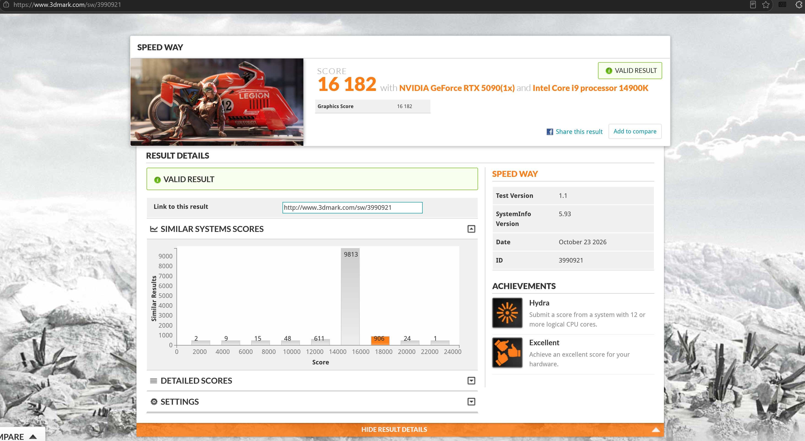
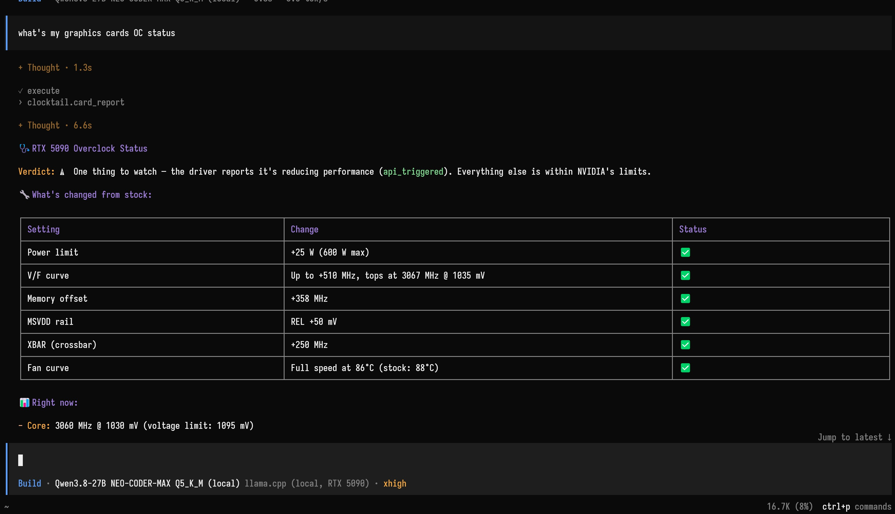
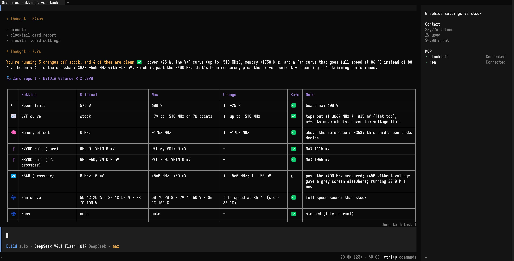
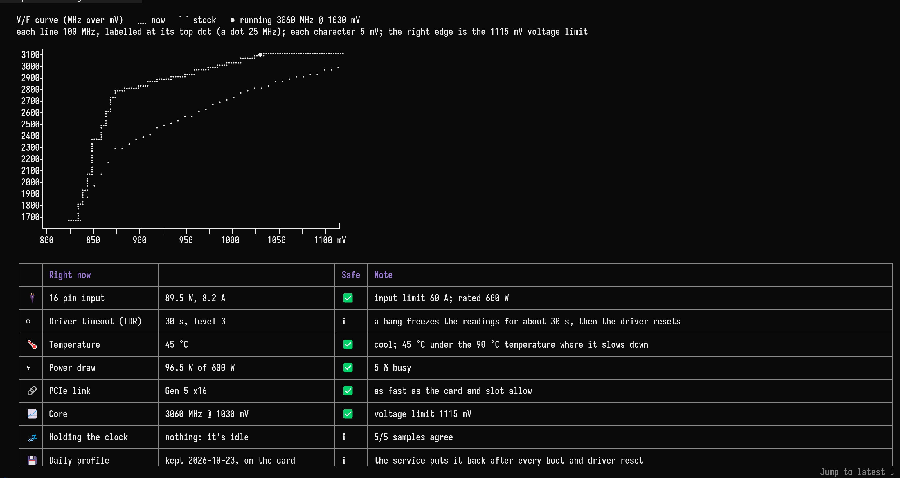
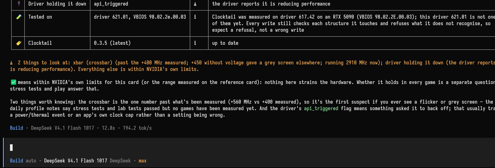
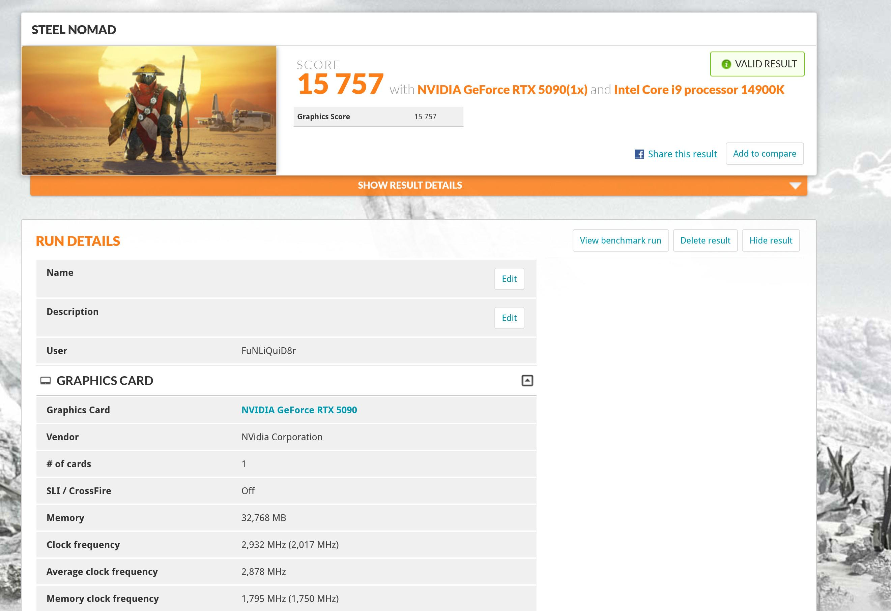

# Clocktail

English | [简体中文](README.zh-CN.md)

**Overclock your RTX 50 card by talking to an AI agent, over MCP.** You play. The agent tunes. NVIDIA's own stress tester settles the arguments.



*3DMark Speed Way on the RTX 5090 Clocktail was built on: 16 182, a valid result. The tall grey bar is where most similar systems land. The orange one is this card.*

So you want to overclock a card that's already this fast. We get it. We won't ask.

- **The agent does the tuning.** The V/F curve, core and memory offsets, XBAR and the other clock domains, the voltage boost, clock locks, power and current limits, the fans. Every control, no "expert mode", no caps of Clocktail's on top of the card's own.
- **Or draw the curve yourself.** Ask for the V/F curve editor and a window opens with your curve, every crash pinned to the point it happened at, past stability tests and the clocks the card actually sampled. Drag, then save.
- **Something other than the agent decides if it's stable.** NVIDIA's stress tester, Clocktail's own lab, and your games, with the frame times to prove it.
- **Nothing sticks unless you say so.** No preset, no default profile. A fresh install writes nothing to your card until you say so.

Meant for the whole RTX 50 series, whoever made the board. Windows x64 and Node.js:

```
npx -y clocktail@latest setup
```

Restart your agent, then ask it *"How's my card doing?"*

> Unofficial software. Overclocking can crash your games, mess up your output and shorten the life of your hardware. NVIDIA accepting a setting doesn't make it stable or safe.

<details>
<summary><b>Setting up, updating, uninstalling</b></summary>

Paste this into your coding agent:

```
Install Clocktail and connect it to this coding agent using npx clocktail@latest setup. Show me the setup plan for approval, then verify the installation.
```

Or run `npx -y clocktail@latest setup` yourself. Either way, setup shows you what it's going to change before it changes anything. You pick the agents, it backs up their config, installs the service, and Windows asks for admin rights once. Restart your agent when it's done.

It works with Claude Code, Claude Desktop, Codex, Cursor, OpenCode, VS Code, Gemini CLI, Windsurf, GitHub Copilot CLI and about a dozen more (the list is borrowed from [REA](https://github.com/morluto/rea), thanks). Anything else that speaks MCP can point at `%LocalAppData%\Programs\Clocktail\clocktail-mcp.exe`.

**Updating.** It doesn't update itself. When a new version is out, "How's my card doing?" mentions it at the bottom. Run the same setup command again (or ask your agent to), restart, done. Keep the MCP server, service and lab on the same version. Your profiles and logs stay where they are. The update check reads exactly one thing from npm, the latest version number, and sends nothing about you or your card. `CLOCKTAIL_NO_UPDATE_CHECK=1` turns it off.

**Uninstalling.**

```
npx -y clocktail uninstall
```

Clocktail puts back every setting it owns, and the service and the agent connections are removed. Your profiles and tuning logs stay in `%LocalAppData%\Clocktail` unless you add `--purge`. The card won't remember any of this.

</details>

<details>
<summary><b>Which model, and small ones</b></summary>

It doesn't have to be Claude. Any model that's decent with tools will do. The card report below is DeepSeek V4.1 Flash in OpenCode, and the whole conversation came to a cent. It can even be a local one, running on the card it's talking about:



*Qwen3.8 27B in llama.cpp, through OpenCode, on the same RTX 5090 it's reporting on. The card took it well.*

**Small model? Go lite.**

```
npx -y clocktail@latest setup --lite
```

The full toolbox is 54 tools and a manual's worth of instructions. A local model in a 32k window can't fit that next to its own agent's prompt, and Ollama won't tell you: it quietly drops the start of the conversation, instructions first, and your agent forgets what it was doing. `--lite` hands the agent 22 tools and a one-page brief. Give Ollama all the context your VRAM allows anyway (`OLLAMA_CONTEXT_LENGTH`; 64k is comfortable).

**The model matters more than the app.** The same Clocktail ran smoothly in Cursor on a frontier model and went in circles on a small free one. Pick the best model you can afford; DeepSeek V4.1 Flash in OpenCode is a fine budget pick.

</details>

<details>
<summary><b>What it tells you</b></summary>

Ask how your card's doing and you get a table: every setting, what it was and what it is now, with a ✅ if it's inside NVIDIA's own limits and a ⚠️ if it isn't.



*Five changes off stock, four of them ✅. The ⚠️ is XBAR at +560 MHz, past what its notes vouch for. It says so.*

Under that, your V/F curve, drawn right in the terminal in Braille dots, btop-style, with a ● where the card is running. Then what the card is doing right now.



*The tuned curve over stock, the ● at 3060 MHz and 1030 mV. 45 °C, 96 W, Gen 5 x16, nothing holding it back. It's idle. For now.*

Then the verdict, in plain words.



*✅ means inside NVIDIA's own limits, not crash-proof, and it tells you so itself. It also names the setting it would blame first if you ever see a grey screen. Somebody has to.*

It also reads the stuff most tools don't show you: the memory temperature, how many watts go through the 16-pin connector, whether the PCIe link has been resending data, which driver limit is really holding your clock back, whether a clock lock actually held (a lock is only a request, and the driver still pulls the clock under it), the XBAR, SYS and video clocks beside the core, how long Windows waits before it resets a hung GPU.

Things to ask:

```
I'm at 2970 MHz and it won't go higher no matter what voltage. What's holding it back, and what would you change?
```

```
I'm playing Cyberpunk tonight on the new curve. Watch the card the whole time. If it crashes, write it down and tune from it.
```

```
Measure these trials, then show me what would be saved before making anything persistent.
```

</details>

<details>
<summary><b>The V/F curve editor: draw it yourself</b></summary>

Rather do the curve by hand? Ask your agent **"Open the V/F curve editor."** A window opens on your desktop with this card's curve, and everything Clocktail has learned about it drawn on top:

- **Every crash, pinned to the point it happened at.** A solid cross means it crashed during a curve trial.
- **Stable settings and sampled clocks, separately.** Green marks show sampled clocks from tests marked stable. Amber hollow marks show a stable setting that was not reached or has no samples. Survived settings have their own dotted marks. Past evidence does not certify your draft.
- **Where the card ran**, as a haze of dots from historical samples taken under load. Brighter dots mean more time; this is a snapshot, not a live monitor. Switch the history, evidence, crashes, opened curve and base clocks on or off.
- **Drag points or enter a precise offset.** A persistent inspector shows voltage, draft and opened clocks, their difference and an editable offset in MHz. Ctrl+Z undoes, Ctrl+Y / Ctrl+Shift+Z redoes, Esc cancels a drag, right-drag pans, and Ctrl+0 fits the view. The low-voltage cliff is reshaped as a smooth band between two draggable lines, and above it the clock never falls, the driver's own rule.
- **Start from the exact curve on the card.** Opening the window preserves the curve. Smooth is an explicit action; Restore opened restores the original offsets and band exactly. Both are undoable.
- **Clean up the history.** Right-click a point, a crash or a stability mark to pick a past test and delete it. It asks first, and the marks are recomputed at once. Your card isn't touched, and the original journal stays for recovery.
- **Nothing is written until you click Save as Daily.** Then the curve goes on as a trial, the readback is checked, and it becomes your daily profile. That click is your approval; the agent won't ask again. The window shows the save result; Details lets you read and copy full diagnostics and see other settings included in Daily. Closing an unsaved draft prompts before discarding it.

Windows only. The window is in English.

</details>

<details>
<summary><b>The judges: stress tester, lab, games</b></summary>

- **NVIDIA's stress tester.** `stress_test` runs `nvgwls.exe`, which ships with your driver; NVIDIA App's auto-tune uses the same program. It checks every result bit for bit. You can't argue with it, and you can't bribe it.
- **A lab for what games can't measure.** `lab_test` runs Clocktail's own load engine, with an instrument for each part of the card: the core, the memory and the crossbar, every result checked exactly. For the top of the curve it brings a soloist that isolates high curve points, and it tells you when the clock didn't actually sit on the point you're testing, instead of calling that a pass. Games don't sit on a point but jump to the top whenever a heavy scene turns light, so it has a leap too: heavy, then light, over and over. Your agent can leave it sweeping the memory offset (`tune_memory`), or hunting for the best mix of XBAR, its ratio and the voltage boost (`tune_uncore`), each candidate compared A B B A. A comparison something disturbed is run again. It keeps nothing until you say so.
- **It plays a game for you while you sleep.** Got Quake II RTX (free on Steam)? `game_test` plays it by a seeded script with nobody at the keyboard, and the same seed replays the same run, so a fix can be checked against the exact moves that broke it. It's optional, and it's evidence, not proof: if you're at the PC anyway, play your own games with the agent watching instead. See [the game-test contract](docs/game-test.md).
- **It counts your frames.** While you play, `watch` and the live tools sample the card four times a second and show your fps, the 1 % and 0.1 % lows and the frame times, through Intel's PresentMon. Nothing gets injected into the game. "Did that help?" gets answered in frames, not vibes.

If the game crashes, that's not a setback, that's data. The crash belongs to the trial that was running, with the clock, voltage, power and temperature it went down at.


*Ask what it tests with and you get the toolbox: two judges, two ways to watch you play, the curve tools. On the card it was built on, games wanted 30–60 MHz back from the stress tester's edge. That's one chip. Yours will have its own number, and only your games know it.*

</details>

<details>
<summary><b>Who says yes</b></summary>

Two things authorize a setting: you, and NVIDIA's driver and firmware. Every write is read back. Clocktail adds no tuning envelope of its own and no mandatory XBAR voltage/clock pairing. What it does keep are the checks that make a write land where it was aimed: encoding, GPU identity, concurrency and recovery. It won't guess between two GPUs, and if it doesn't recognize a driver layout it says so rather than borrowing another card's.

`begin_session` asks you once for a round of trials. Trials are recorded and undone on their own. The changes that stay, a daily profile, the daily power limit, Clocktail asks you about itself, right in your agent's chat: the first call changes nothing and hands your agent the question with a one-time code, and only after your yes does it call again with that code. A model that skips the question could answer it itself, so if you want a yes no model can give, `CLOCKTAIL_CONFIRM=form` asks in an MCP form or a Windows dialog instead (`dialog` always uses the Windows dialog). `CLOCKTAIL_CONFIRM=off` no longer skips the question; it asks in chat like the default.

Some agents run every tool without asking (Freebuff, anything in YOLO mode). The above is why that's survivable. The other way round, Claude Code asks before every single read. `npx -y clocktail setup --allow-reads` lets the read-only tools through (card_report, gpu_status and friends); every write still asks.

stress_test and lab_test stop when the card gets within 2 °C of NVIDIA's own slowdown point, or at a `maxTempC` you set. game_test stops only at your `maxTempC`, and the memory and uncore sweeps don't stop for heat at all. NVIDIA's own protections stay on. Nothing gets written while the GPU looks hung. Leave an unattended session running and it stops writing new trials after the crash budget you set (two, unless you say otherwise).

</details>

<details>
<summary><b>Your profiles, and other tools' leftovers</b></summary>

Stock is whatever the current card's firmware says. A daily profile exists only once you've picked settings to keep. Your profiles and logs are yours; updates don't replace them with anything bundled.

- `preview_daily` shows exactly what would be kept, and which temporary controls are left out. `keep_as_daily` keeps it, after you say yes.
- Keep as many profiles as you like with `save_profile`. "Quiet", "games", whatever you want. Switch with a sentence. (`list_presets` and `load_preset` are the old names; they list and load your own profiles. The built-in list is empty.)
- A background service puts your daily profile back after every reboot, wake-up and driver reset, including the ones you caused. A profile kept on another VBIOS waits for your OK. With no daily profile, it puts back only what Clocktail changed.
- `stock` clears every known non-stock setting and suspends the daily profile. It asks first, because it keeps no copy of what other tools left.

**Already tuned in MSI Afterburner?** Clocktail notices. Whatever another tool left on the card (an undervolt curve, a memory offset, a power limit, fixed fans) shows up in "How's my card doing?" as **Not set by Clocktail**, so your agent won't mistake your undervolt for NVIDIA's curve. Then it's your call: tune from it, wipe it with `stock`, or hand it over (`keep_as_daily` with `adopt`; the power limit goes in with `set_daily_power_limit`) and let Afterburner retire. If Afterburner is still running, it says so: two programs writing the same card is a fight nobody wins. NVIDIA App's automatic tuning lives in the driver and comes back after every restart, so switch it off in NVIDIA App if you want stock to stay stock.

</details>

<details>
<summary><b>Which cards</b></summary>

The RTX 50 series, across models and board vendors, on Windows x64 with the NVIDIA driver loaded. What each card can do is read from that card, board and driver; not every sensor or control exists on every model. Series-wide doesn't mean every control has been tried on every board and driver. There's no universal power limit, voltage, offset, fan curve or "stable curve" in the box. Your card is different. Your card is always different.

</details>

<details>
<summary><b>What it found on the one card we tested</b></summary>

RTX 5090 Founders Edition, driver 617.42 (and then 621.01, see the last three rows), Windows 11. Your card is different. Your card is always different.

| Setting | Result |
|---|---|
| MSVDD REL −50 → 0 mV (NVIDIA's own limit) | Blender +2 %. Free, which is the best price. |
| XBAR +300 MHz with +20 mV of voltage demand | Blender +6–7 % over stock. |
| XBAR past ~+300 MHz without the extra voltage | MSVDD drops to its floor and memory-heavy work loses up to 16 %. Don't. We did, so you don't have to. |
| XBAR +400 MHz / +50 mV, ratio 0.95, MSVDD REL +50 / ALT +30 mV | The lab's crossbar test 5–6 % faster than the card's previous daily settings, and it passed the stress tester at full and light load. It was that card's daily on driver 617.42. Games not measured yet. |
| Memory +1758 MHz, on top of that | Not a single error in the lab all the way to +3000, but bandwidth stops climbing around +1758. 3DMark Speedway liked it a little better than +358; +2900 was no faster in Speedway or Steel Nomad. Past the plateau you only buy latency, and frames don't feel it. |
| Driver 621.01 | It takes every NVVDD and MSVDD voltage write, says OK and changes nothing, reboot or not. So MSVDD stays stock and the ratio stops paying (0.925 and 0.95 only slowed the core). XBAR still pays on its own: +400 MHz / +50 mV at ratio 0.9 got the crossbar test about 10 % faster than stock. Clocktail puts the rest of a profile on and tells you which part the driver wouldn't take. |
| Voltage boost 100 %, on 621.01 | The one voltage control 621.01 still takes: every rail's limit +20 mV, 5 mV per 25 %. It turned out to be what the ratio was missing: XBAR +500 MHz / +50 mV, ratio 0.95, boost 100 % got the crossbar test another 7 % and memory bandwidth 4.5 % over the +400 / 0.9 settings, and passed the lab and the stress tester at full and half load. Clocktail dropped its MSVDD and NVVDD offset tools for it. |
| XBAR in 30 MHz steps, on 621.01 | Every step from +320 to +590, each against +500: the crossbar test climbs all the way to +560 (another 1 %), and +590 gives a little of it back. +560 passed the lab and the stress tester at full and half load, and it's the card's daily now, the one in the screenshots. Games not measured yet. |

For a while we thought XBAR offsets past +300 bought nothing. Turns out they do, just not on their own. XBAR sits squeezed between 0.9 × the core clock below and whatever MSVDD's voltage allows above, and the two are only about 30 MHz apart. Raise one and nothing happens. Raise the ratio and MSVDD together and the window opens up, and then the XBAR offset starts paying. The tuner figured that out, not us. Higher numbers still aren't always better numbers. Sometimes they just need friends.

And once the crossbar stopped holding it back, the memory had room too: 7.8 % more bandwidth at the very same offset, and for the first time it actually scaled with the memory clock.




*3DMark Steel Nomad on an RTX 5090 tuned with Clocktail: 15 757, a valid result, at an average 2,878 MHz. The reference card's earlier run on the founders profile scored 15 177.*

</details>

<details>
<summary><b>By hand, and what's in the box</b></summary>

Connect any stdio MCP client to `clocktail-mcp.exe` (add `--lite`, or set `CLOCKTAIL_TOOLS=lite`, for the small tool set). Install the matching service with `Clocktail.Broker.exe install`, or skip it: your agent calls `install_service` the first time it needs to write something. The default folder is `%LocalAppData%\Programs\Clocktail`.

Or paste the setup line into your agent and go make a cup of tea. Robot work is best left to robots.

To build from source (Windows, .NET 10 SDK):

```
dotnet test tests/Clocktail.Tests/Clocktail.Tests.csproj
dotnet build Clocktail.slnx -c Release
```

The tests run against a fake driver. They never touch the GPU.

| Folder | What it is |
|---|---|
| `src/Clocktail.Hw` | The only code that talks to the driver (NVAPI, NVML), and the checks on every driver structure it touches. |
| `src/Clocktail.Domain` | Transactions, the ownership journal, recovery and your profiles. |
| `src/Clocktail.Broker` | The service: it does every write and puts your daily profile back after crashes and driver resets. |
| `src/Clocktail.Cli` | The command line, for people who'd rather break things by hand. |
| `tools/Clocktail.Mcp` | The MCP server your agent talks to, and [its manual](tools/Clocktail.Mcp/README.md). |
| `tools/Clocktail.Lab` | The lab's load engine and the game test's director. |
| `npm/` | The setup genie behind `npx clocktail`. |

</details>

<details>
<summary><b>If your card answers differently</b></summary>

Ask your agent for a diagnostic report (`diagnostic_report`) and attach it to an [issue](https://github.com/swaggypatrol/Clocktail/issues). Versions, capabilities, and how the driver answered every read. Making it writes nothing to the card, and it goes nowhere until you post it.

Frame rates come from Intel's [PresentMon](https://github.com/GameTechDev/PresentMon); see [THIRD_PARTY_NOTICES.md](THIRD_PARTY_NOTICES.md).

This is unofficial software. Use it at your own risk. If something goes wrong, the tuning log will tell you exactly what happened. It won't say sorry.

</details>
