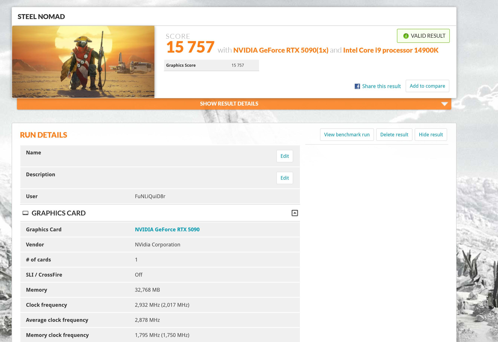

# Clocktail

English | [简体中文](README.zh-CN.md)

Clocktail lets an MCP client measure and tune the voltage–frequency curve of an NVIDIA GeForce RTX 50 GPU on Windows x64. It reads the effective curve from the driver, runs repeatable workloads, and records the voltages and clocks the GPU actually reached. The supported hardware path requires compute capability 12.0. B100, B200 and GB200 systems are outside that path.

## Install

Install Node.js 18 or later and run this in a Windows terminal to install the published version.

```powershell
npx -y clocktail@latest setup
```

Setup shows its plan, backs up the selected clients' configurations and requests elevation to install the broker. Restart the client and ask it to run `card_report`. If several supported GPUs are present, set `CLOCKTAIL_GPU_PCI` to the same intended address (for example `0000:01:00.0`) in the MCP and broker environments. Restart both and check the reported PCI address.

The default list contains 23 tools for inspection, V/F and memory trials, testing and recovery. For the full catalogue, including the curve editor, clock locks and game automation, run setup with `--full`. Manual stdio clients can launch `%LocalAppData%\Programs\Clocktail\clocktail-mcp.exe` with `--full`, or set `CLOCKTAIL_TOOLS=full`. Existing `--lite` setups continue to work.

## Measure a curve point

1. Run `card_report` to identify the GPU, driver, current settings and any offsets left by other utilities. Use `limiter` and `curve_around` at the voltage reached by your workload. Choose a point index from this card's curve.
2. Run `lab_test` with the chosen `targetPoint`. The `aria` profile checks FP32 results against a CPU reference. The default `core` profile exercises sustained load, high clocks and heavy/light transitions. Keep the workload, seed where applicable, power limit and cooling comparable across trials.
3. Inspect the workload verdict and each phase's `paired_samples`, `target_samples` and `most_sampled_vf`. A zero target count means the paired polls missed the requested point. A null count means the target or paired telemetry was unavailable. Sample counts describe visits within the phase window, including CPU checks and pauses.
4. With trial consent, call `begin_session`, change one region with `adjust_curve`, check the driver readback and repeat the same test. Use `data_points` for previous trial outcomes. Confirm the candidate under the intended application, at its normal operating temperature.
5. Use `back_to_daily` to restore the previous settings, or inspect `preview_daily` and approve `keep_as_daily` to persist the candidate. Persistent profile changes also require the broker's Windows confirmation.

For example, if `curve_around` returned point 91, an MCP client can call `lab_test` with these arguments.

```json
{"profile": "aria", "targetPoint": 91, "seed": "5eed5eed5eed5eed"}
```

The workload measures correctness under the conditions of that run. Thermal limits, other GPU work and transitions change which V/F points it exercises. Overclocking can corrupt results, reset the driver or damage hardware. Clocktail ships with an empty daily profile store.

## Operations

- **Recovery.** The broker journals settings that Clocktail changes and restores them or the approved daily profile after a driver reset. `stock` also clears settings left by other tools and requires confirmation. [Broker approval and recovery](docs/broker-approval-boundary.md)
- **Workloads.** Use the built-in lab for core, memory and uncore tests. NVIDIA's `nvgwls` and a locally installed Quake II RTX provide independent checks. Frame capture uses Intel PresentMon. [Lab](docs/lab.md) · [Game test](docs/game-test.md) · [Third-party notices](THIRD_PARTY_NOTICES.md)
- **Updates.** Rerun setup and restart the client to update the server, broker and lab together. Uninstall with `npx -y clocktail uninstall`. Profiles and logs stay under `%LocalAppData%\Clocktail` unless you request `--purge`.
- **Diagnostics.** `diagnostic_report` collects local driver and capability details. [MCP reference](tools/Clocktail.Mcp/README.md) · [V/F history](docs/vf-history.md)

## Build and test

Use the .NET 10 SDK. The automated tests use simulated drivers. Physical tuning requires Windows x64 and a supported GPU.

```sh
dotnet test tests/Clocktail.Tests -c Release
node --test npm/test/clients.test.js
```

<details>
<summary><b>What it found on the one card we tested</b></summary>

RTX 5090 Founders Edition, driver 617.42 (and then 621.01, see the last three rows), Windows 11. Your card is different. Your card is always different.

| Setting | Result |
|---|---|
| MSVDD REL −50 → 0 mV (NVIDIA's own limit) | Blender +2 %. Free, which is the best price. |
| XBAR +300 MHz with +20 mV of voltage demand | Blender +6–7 % over stock. |
| XBAR past ~+300 MHz without the extra voltage | MSVDD drops to its floor and memory-heavy work loses up to 16 %. Don't. We did, so you don't have to. |
| XBAR +400 MHz / +50 mV, ratio 0.95, MSVDD REL +50 / ALT +30 mV | The lab's crossbar test 5–6 % faster than the card's previous daily settings, and it passed the stress tester at full and light load. It was that card's daily on driver 617.42. Games not measured yet. |
| Memory +1758 MHz, on top of that | Not a single error in the lab all the way to +3000, but bandwidth stops climbing around +1758. 3DMark Speedway liked it a little better than +358; +2900 was no faster in Speedway or Steel Nomad. Past the plateau you only buy latency, and frames don't feel it. |
| Driver 621.01 | It takes every NVVDD and MSVDD voltage write, says OK and changes nothing, reboot or not. So MSVDD stays stock and the ratio stops paying (0.925 and 0.95 only slowed the core). XBAR still pays on its own: +400 MHz / +50 mV at ratio 0.9 got the crossbar test about 10 % faster than stock. Clocktail puts the rest of a profile on and tells you which part the driver wouldn't take. |
| Voltage boost 100 %, on 621.01 | The one voltage control 621.01 still takes: every rail's limit +20 mV, 5 mV per 25 %. It turned out to be what the ratio was missing: XBAR +500 MHz / +50 mV, ratio 0.95, boost 100 % got the crossbar test another 7 % and memory bandwidth 4.5 % over the +400 / 0.9 settings, and passed the lab and the stress tester at full and half load. Clocktail dropped its MSVDD and NVVDD offset tools for it. |
| XBAR in 30 MHz steps, on 621.01 | Every step from +320 to +590, each against +500: the crossbar test climbs all the way to +560 (another 1 %), and +590 gives a little of it back. +560 passed the lab and the stress tester at full and half load, and it's the card's daily now, the one in the screenshots. Games not measured yet. |

For a while we thought XBAR offsets past +300 bought nothing. Turns out they do, just not on their own. XBAR sits squeezed between 0.9 × the core clock below and whatever MSVDD's voltage allows above, and the two are only about 30 MHz apart. Raise one and nothing happens. Raise the ratio and MSVDD together and the window opens up, and then the XBAR offset starts paying. The tuner figured that out, not us. Higher numbers still aren't always better numbers. Sometimes they just need friends.

And once the crossbar stopped holding it back, the memory had room too: 7.8 % more bandwidth at the very same offset, and for the first time it actually scaled with the memory clock.




*3DMark Steel Nomad on an RTX 5090 tuned with Clocktail: 15 757, a valid result, at an average 2,878 MHz. The reference card's earlier run on the founders profile scored 15 177.*

</details>
