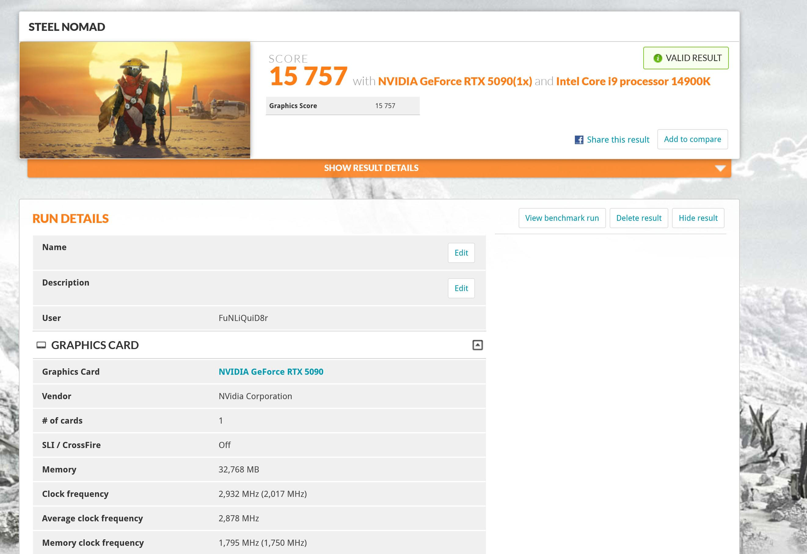

# Clocktail

[English](README.md) | 简体中文

Clocktail 通过 MCP 在 Windows x64 上测量和调校 NVIDIA GeForce RTX 50 系列显卡的电压／频率曲线。它读取驱动实际生效的曲线，用可重复的负载校验计算结果，同时记录显卡在负载下到达的电压和频率。硬件调校路径要求 CUDA 计算能力 12.0。B100、B200 和 GB200 不在这条路径的支持范围内。

## 安装

先安装 Node.js 18 或更新版本，再在 Windows 终端安装已发布版本。

```powershell
npx -y clocktail@latest setup
```

安装器会展示计划、备份所选 MCP 客户端的配置，并为安装后台服务请求管理员权限。重启客户端，让它运行 `card_report`。如果机器上有多张受支持的卡，在 MCP 和后台服务的环境变量 `CLOCKTAIL_GPU_PCI` 中填入同一个目标 PCI 地址（例如 `0000:01:00.0`）。重启两者后，核对报告中的 PCI 地址。

默认列出 23 个工具，覆盖读卡、V/F 与显存调试、测试和恢复。需要曲线编辑器、频率锁或自动游戏测试时，用 `--full` 再运行一次 setup。手动配置的客户端可以用 `--full` 启动 `%LocalAppData%\Programs\Clocktail\clocktail-mcp.exe`，也可以设置 `CLOCKTAIL_TOOLS=full`。已有的 `--lite` 配置继续有效。

## 测一个 V/F 点

1. 用 `card_report` 核对显卡、驱动、当前设置，以及其他工具留下的偏移。用 `limiter` 查看限制因素，再用 `curve_around` 查看实际负载电压附近的曲线，从这张卡上选一个点号。
2. 把点号作为 `targetPoint` 传给 `lab_test`。`aria` 用 CPU 参考结果逐位核对 FP32 运算。默认的 `core` 覆盖持续负载、高频和轻重负载切换。做前后对照时，保持工作负载、适用的随机种子、功耗上限和散热条件一致。
3. 查看计算结果和每个阶段的 `paired_samples`、`target_samples`、`most_sampled_vf`。命中数为 0 表示有效的成对采样都没有命中目标。空值表示未指定目标点或缺少成对读数。计数对应整个阶段内的轮询，包含 CPU 校验和停顿。
4. 经用户同意，用 `begin_session` 开启试验，调用 `adjust_curve` 调整一个区段，核对驱动回读，再重复同一负载。`data_points` 可回看历史试验。选出候选配置后，在实际应用和日常工作温度下复测。
5. 用 `back_to_daily` 恢复原设置。若要长期保留，先看 `preview_daily`，再批准 `keep_as_daily`。持久化变更还需在后台服务弹出的 Windows 窗口中确认。

假设这张卡的 `curve_around` 返回了点号 91，下面是一次 `lab_test` 的 MCP 参数。

```json
{"profile": "aria", "targetPoint": 91, "seed": "5eed5eed5eed5eed"}
```

结果描述这张卡在本次负载下的计算正确性和采样情况。温度、后台任务和负载切换都会改变实际覆盖的 V/F 点。超频可能造成计算错误、驱动复位或硬件损伤。首次安装时，日常配置列表为空。

## 使用与维护

- **恢复。** 后台服务记录 Clocktail 接手的设置，驱动复位后据此恢复或重放已批准的日常配置。`stock` 还会清除其他工具留下的设置，执行前会请求确认。[后台服务的确认与恢复机制](docs/broker-approval-boundary.md)
- **负载。** 内置实验室覆盖核心、显存和 uncore。可选的独立验证包括 NVIDIA 的 `nvgwls` 和本机安装的 Quake II RTX。帧时间采集使用 Intel PresentMon。[实验室](docs/lab.md) · [游戏测试](docs/game-test.md) · [第三方声明](THIRD_PARTY_NOTICES.md)
- **更新。** 重新运行 setup 并重启客户端，确保 MCP、后台服务和实验室版本一致。用 `npx -y clocktail uninstall` 卸载。除非显式使用 `--purge`，配置和日志会保留在 `%LocalAppData%\Clocktail`。
- **诊断。** `diagnostic_report` 可导出本机驱动和功能探测信息。[MCP 工具手册](tools/Clocktail.Mcp/README.md) · [V/F 历史记录](docs/vf-history.md)

## 构建与测试

使用 .NET 10 SDK。自动化测试使用模拟驱动。上卡调校需要 Windows x64 及受支持的 GPU。

```sh
dotnet test tests/Clocktail.Tests -c Release
node --test npm/test/clients.test.js
```

<details>
<summary><b>在我们这张卡上测到的</b></summary>

只测过一张卡：RTX 5090 公版，驱动 617.42（后来换了 621.01，见最后三行），Windows 11。你的卡不一样，每张卡都不一样。

| 设置 | 结果 |
|---|---|
| MSVDD REL −50 → 0 mV（NVIDIA 自己的上限） | Blender 快 2 %。不要钱，最划算。 |
| XBAR +300 MHz，电压需求 +20 mV | Blender 比出厂快 6–7 %。 |
| XBAR 超过 +300 左右却不加电压 | MSVDD 掉到底，吃显存的负载最多慢 16 %。别这么干，我们替你干过了。 |
| XBAR +400 MHz / +50 mV，比例 0.95，MSVDD REL +50 / ALT +30 mV | 实验室的 crossbar 测试比这张卡之前的日常设置快 5–6 %，满载和轻载压测都过了，这是它在 617.42 驱动下的日常设置。游戏里还没测。 |
| 在此基础上显存 +1758 MHz | 实验室里一路到 +3000 一个错都没有，但带宽到 +1758 左右就不涨了。3DMark Speedway 比 +358 好一点，+2900 在 Speedway 和 Steel Nomad 里都没更快。过了平台期只剩延迟更低，帧数感觉不到。 |
| 621.01 驱动 | NVVDD 和 MSVDD 的电压写入，它一律回“成功”，然后什么都不改，重启也一样。所以 MSVDD 只能原厂，比例也不再有用（0.925 和 0.95 只会拖慢核心）。XBAR 自己还能出力：比例 0.9 下 +400 MHz / +50 mV，crossbar 测试比原厂快 10 % 左右。Clocktail 会把配置里其余部分照常写上，并告诉你驱动不收哪一部分。 |
| 621.01 下的电压加成 100 % | 621.01 唯一还收的电压开关：每条电压轨的上限 +20 mV，每 25 % 加 5 mV。比例缺的正是它：XBAR +500 MHz / +50 mV、比例 0.95、电压加成 100 %，crossbar 测试比 +400 / 0.9 那组又快 7 %，显存带宽快 4.5 %，实验室和压测在满载、半载下都过了。Clocktail 因此去掉了调 MSVDD 和 NVVDD 偏移的工具。 |
| 621.01 下 XBAR 按 30 MHz 一档细扫 | 从 +320 到 +590，每一档都跟 +500 比：crossbar 测试一路涨到 +560（又快了 1 %），到 +590 又吐回去一点。+560 过了实验室和满载、半载压测，现在就是这张卡的日常设置，截图里的就是它。游戏里还没测。 |

我们一度以为 XBAR 偏移过了 +300 就白给。其实不是，只是它一个人使不上劲：XBAR 被夹在中间，下面是核心频率的 0.9 倍，上面是 MSVDD 电压能撑到的频率，两头只差 30 MHz 左右。只抬一头，纹丝不动；比例和 MSVDD 一起抬，窗口才打开，XBAR 偏移这才开始见效。这是调参工具自己摸出来的，不是我们。数字大不一定就好，有时候它只是缺个帮手。

crossbar 一松开，显存也跟着有了余地：同样的偏移，带宽多了 7.8 %，而且头一回真的跟着显存频率往上涨。




*用 Clocktail 调过的 RTX 5090 跑 3DMark Steel Nomad：15 757 分，有效成绩，平均频率 2,878 MHz。参考卡之前用 founders 预设跑过 15 177 分。*

</details>
