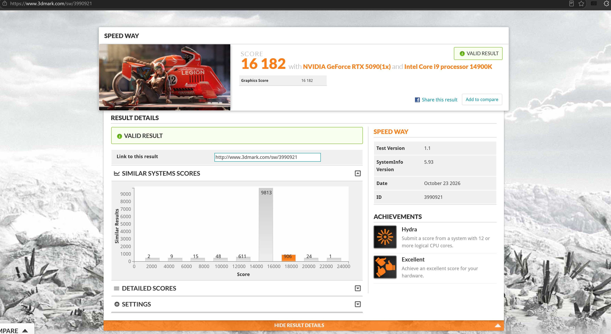
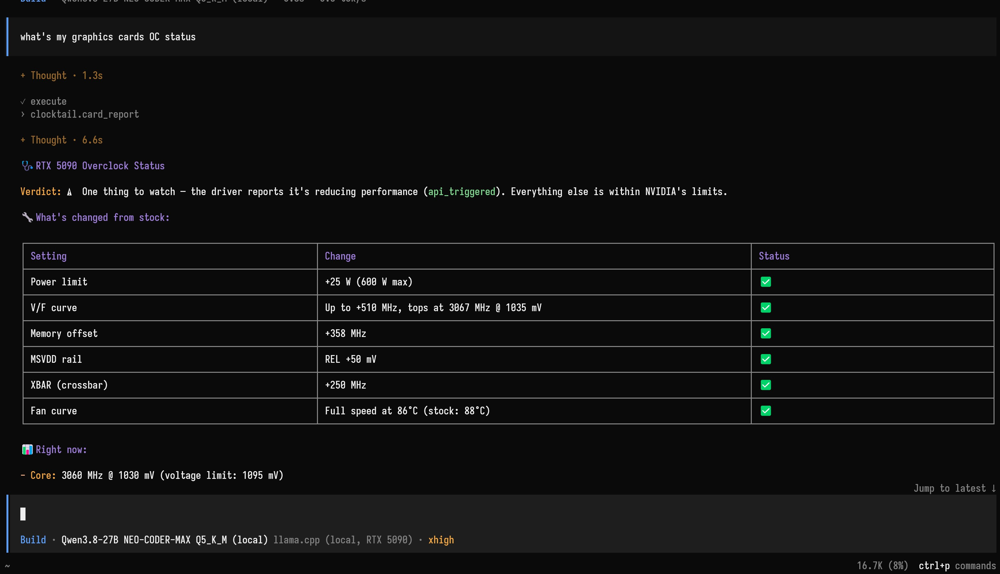
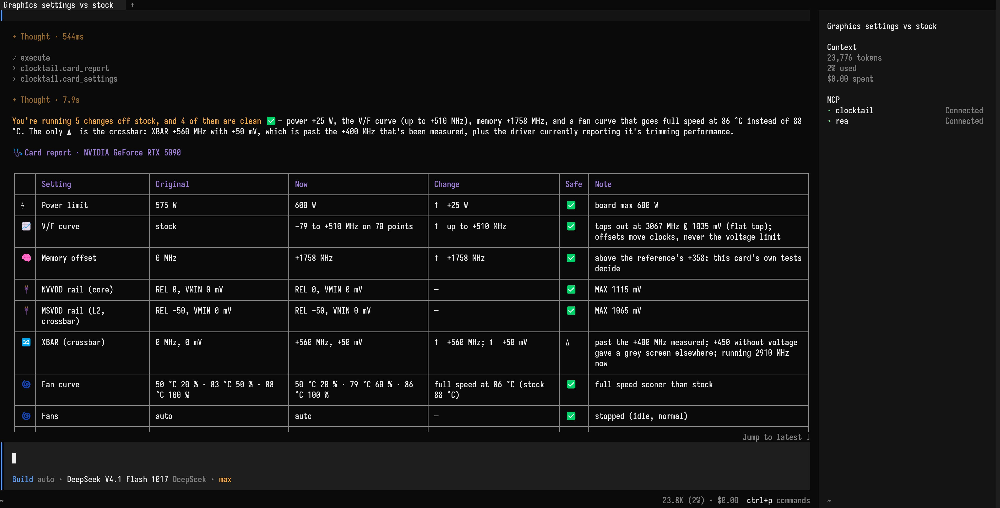
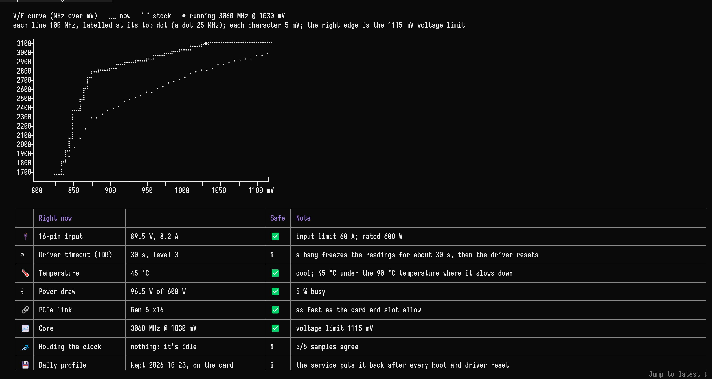
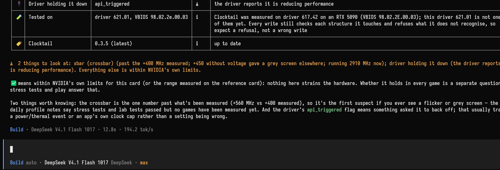
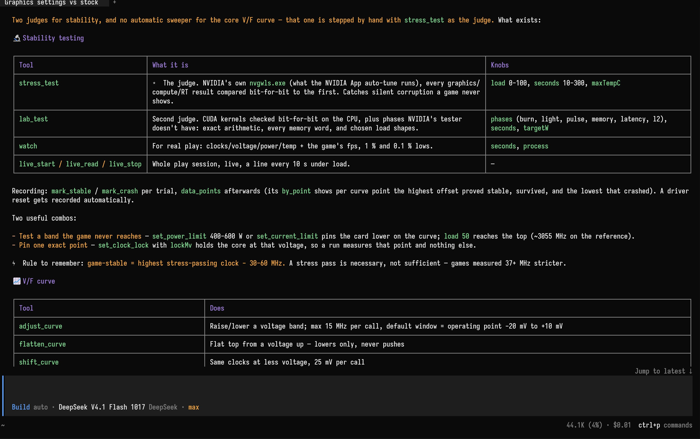
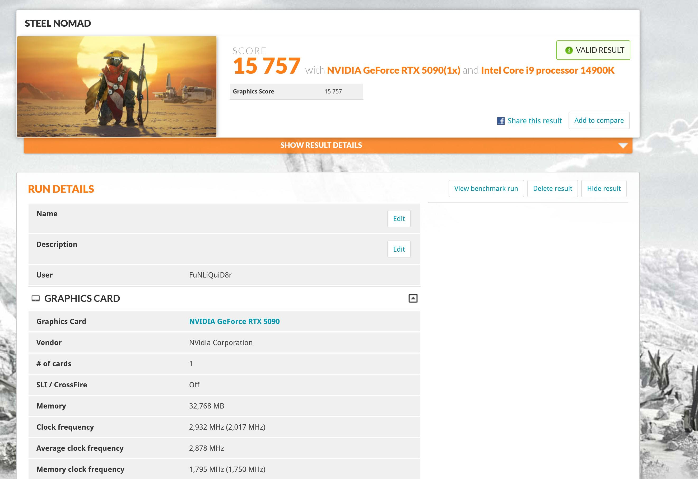

# Clocktail

[English](README.md) | 简体中文

**让 AI 助手给你的 RTX 50 系显卡超频，走 MCP 协议。** 你打游戏，AI 调卡，稳不稳由 NVIDIA 自家的压测工具说了算。吵不起来。



*Clocktail 起家的那张 RTX 5090 跑 3DMark Speed Way：16 182 分，有效成绩。灰色高柱是同类系统扎堆的地方，橙色那根是这张卡。*

一张本来就很快的显卡，你还想让它再快一点。懂，不问。

- **调参交给 AI。** V/F 曲线、核心和显存偏移、XBAR 等时钟域、电压加成、频率锁、功耗墙和电流墙、风扇。所有开关都给它，没有“专家模式”，在显卡自己的范围之外 Clocktail 不另加上限。
- **稳不稳，不由 AI 自己说。** NVIDIA 的压测工具、Clocktail 自带的实验室，还有你的游戏，拿帧数说话。
- **你不点头，什么都不留。** 没有预设，没有默认配置。在你开口之前，Clocktail 不会往显卡写任何东西。

面向整个 RTX 50 系列，不管是哪家做的板卡。需要 Windows x64 和 Node.js：

```
npx -y clocktail@latest setup
```

重启 AI 助手，然后问它一句：*“我的卡现在怎么样？”*

> 非官方软件。超频可能导致游戏崩溃、画面出错、硬件减寿。NVIDIA 接受某个设置，不代表它稳定或安全。

<details>
<summary><b>安装、更新、卸载</b></summary>

把下面这段话原样发给你的编程助手（Claude Code、Codex、Cursor、Trae、Qwen Code、Kimi Code、OpenCode 都行）：

```
用 npx clocktail@latest setup 安装 Clocktail，并接入你自己。先把安装计划给我看，我同意了再装，装完帮我验证一遍。
```

想自己动手也行，直接运行 `npx -y clocktail@latest setup`。安装程序会先列出它在你电脑上找到的 AI 助手和要改的配置（改之前都会备份），你点头了才动手。中间 Windows 会弹一次管理员权限，同意就行。装完重启一下 AI 助手。

npm 下载慢的话，先换国内镜像：`npm config set registry https://registry.npmmirror.com`

支持 Claude Code、Claude Desktop、Codex、Cursor、OpenCode、VS Code、Gemini CLI、Windsurf、GitHub Copilot CLI 等十几种（名单借自 [REA](https://github.com/morluto/rea)，谢过）。其他会说 MCP 的，指向 `%LocalAppData%\Programs\Clocktail\clocktail-mcp.exe` 即可。

**更新。** 它不会自己更新。出了新版，问一句“我的卡现在怎么样”，表格最后会提醒你。再跑一遍安装命令（也可以让 AI 替你跑），重启 AI 助手就好。MCP 服务器、后台服务和实验室要保持同一版本。你存的配置和日志都不会动。检查更新时它只去 npm 看一眼最新版本号，你电脑和显卡的信息一概不发。不想让它查，设 `CLOCKTAIL_NO_UPDATE_CHECK=1`。

**卸载。**

```
npx -y clocktail uninstall
```

Clocktail 持有的每一项设置都会改回去，后台服务和 AI 助手里的配置也会删掉。你的配置和调校记录默认留在 `%LocalAppData%\Clocktail`，加 `--purge` 一起删。显卡不会记得发生过什么。

</details>

<details>
<summary><b>用哪个模型，以及小模型怎么办</b></summary>

不一定非得用 Claude。只要模型会好好调用工具就行。下面那份体检报告，是 OpenCode 里的 DeepSeek V4.1 Flash 出的，整段对话花了一美分。本地模型也可以，哪怕就跑在它要汇报的那张显卡上：



*Qwen3.8 27B 跑在 llama.cpp 里，接 OpenCode，用的正是它在汇报的这张 RTX 5090。显卡给自己写体检报告，倒也坦荡。*

**模型小？上精简版。**

```
npx -y clocktail@latest setup --lite
```

完整版有 53 个工具，外加一本手册那么多的说明。上下文只有 32k 的本地模型，塞完 AI 助手自己的提示词就装不下了，而且 Ollama 不会告诉你：它悄悄把对话开头扔掉，最先扔的就是这些说明，AI 聊着聊着就忘了自己在干什么。`--lite` 只给 22 个工具和一页纸的简报。就算用了 lite，也照样给 Ollama 开到显存撑得住的最大上下文（`OLLAMA_CONTEXT_LENGTH`，64k 就很宽裕）。

**用哪个模型，比用哪个软件要紧。** 同一个 Clocktail，在 Cursor 里接顶级模型一路顺畅，换成免费的小模型就开始原地转圈。挑你用得起的最好的模型；预算紧的话，OpenCode 里的 DeepSeek V4.1 Flash 就很划算。

</details>

<details>
<summary><b>它会告诉你什么</b></summary>

问一句“我的卡现在怎么样”，它会列一张表：每项设置出厂是多少、现在是多少，在 NVIDIA 自家限值以内的打 ✅，超出的打 ⚠️。



*相对出厂改了五项，四项打 ✅。唯一的 ⚠️ 是 XBAR +560 MHz，超出了它备注里敢担保的范围，它就直说。*

下面再像 btop 那样，用盲文点阵在终端里画出 V/F 曲线，● 标出显卡此刻跑在哪。再往下，是显卡这会儿在干什么。



*调过的曲线压在出厂的上面，● 停在 3060 MHz、1030 mV。45 °C，96 W，PCIe 5.0 x16，没有什么压着它。闲着呢。暂时。*

最后是一段大白话结论。



*✅ 的意思是在 NVIDIA 自家限值以内，不是保证不崩，这话它自己会说。哪天真灰屏了先怪谁，它也替你想好了。总得有人背锅。*

别的软件不太给你看的，它也读：显存温度、16-pin 接口上走了多少瓦、PCIe 链路有没有在重传数据、驱动到底是拿哪条限制压住了频率，还有 Windows 要等多久才会重置卡死的显卡。

可以这样问：

```
我的卡卡在 2970 MHz，加电压也上不去，是被什么限制住了？你打算怎么改？
```

```
今晚用新曲线打赛博朋克，你全程盯着显卡。要是崩了，就记下来当调参数据。
```

```
帮我比较这些试验，先展示最终会保存哪些参数，我确认后再设为日常配置。
```

想亲手画曲线？说 **“打开 V/F 曲线编辑器”** 就行。英文桌面窗口会显示曲线、崩溃标记、稳定性记录和实际运行点；拖动编辑，点 **Confirm & Save as Daily** 才会应用。右键曲线点或历史记录标记，可选择并确认删除一条过去的测试。删除立即生效，与保存曲线无关；原始日志保留用于恢复。

</details>

<details>
<summary><b>裁判：压测、实验室、游戏</b></summary>

- **NVIDIA 自家的压测工具。** `stress_test` 调用显卡驱动自带的 `nvgwls.exe`（NVIDIA App 的自动超频用的就是它），每个结果都逐位比对。铁面无私，收买不了。
- **游戏测不出来的，交给实验室。** `lab_test` 跑 Clocktail 自己的负载引擎，核心、显存、crossbar 各有各的乐器，所有结果都严格核对。曲线顶端交给独奏者，专门盯高频点；频率没真落在你要测的那个点上，它就直说，不算通过。游戏也不会老老实实停在一个点上：重场景一变轻，频率就一下冲上曲线顶端。所以还有一个“跳跃”测试：先满载、再轻载，反复来回。你可以让 AI 自己去扫显存偏移（`tune_memory`），或者找 XBAR、比例和电压加成的最佳组合（`tune_uncore`），每个候选都按 A B B A 比一遍；测到一半被打扰的那轮，会重测。你不点头，什么都不留。
- **你睡觉，它替你打游戏。** 装了 Quake II RTX（Steam 上免费）的话，`game_test` 会按带种子的脚本自己玩，键盘前不用有人；同一个种子能把同一局原样重放，修完可以拿当初挂掉的那串动作再验一遍。它是可选的，是证据，不是保证：你本来就在电脑前的话，直接玩你自己的游戏、让 AI 盯着更好。详见 [game test 说明](docs/game-test.md)。
- **帧数它自己会看。** 你打游戏时，`watch` 和实时观察工具每秒看四次显卡，平均帧、1% 和 0.1% 低帧、帧生成时间都看得到，用的是 Intel 的 PresentMon，不往游戏里注入任何东西。“调了有没有用”，拿帧数说话，不凭感觉。

游戏崩了也不白崩：这次崩溃记在当时那个试验头上，崩在什么频率、什么电压、多少瓦、多少度，都有记录。



*问它拿什么测稳定，它把家底摊开：两个裁判、两种盯游戏的办法、调曲线的工具。在 Clocktail 起家的那张卡上，游戏要比压测的边界退 30–60 MHz 才不崩。那是一颗芯片的数。你的卡有它自己的数，只有你的游戏知道。*

</details>

<details>
<summary><b>谁说了算</b></summary>

能放行一个设置的只有两方：你，和 NVIDIA 的驱动与固件。每次写入都会回读核对。Clocktail 不另设调参上限，也不强制 XBAR 电压/频率配对；保留的只是让写入落到该落的地方的那些校验：参数编码、显卡身份、并发和恢复。两张显卡分不清，它不猜；驱动结构认不出，它直说，不拿别的卡的数据凑数。

`begin_session` 先问你一次，批准这一轮试验。试验都有记录，到点自己会撤回。真正会留下来的改动，比如日常配置、日常功耗墙，Clocktail 会亲自来问你，就在 AI 助手的对话里：第一次调用什么都不改，只把问题和一个一次性确认码交给 AI 助手，等你说“好”，它才能带着这个码再调用一次。不守规矩的模型可能替你回答，所以你要是想要一个模型替不了的确认，就设 `CLOCKTAIL_CONFIRM=form`，改在 MCP 表单或 Windows 对话框里问（`dialog` 则始终用 Windows 对话框）。`CLOCKTAIL_CONFIRM=off` 已经跳不过这一步了，照样在对话里问。

有些 AI 助手调用工具从来不问你（比如 Freebuff，或者任何开了 YOLO 模式的），上面这套就是它出不了大事的原因。Claude Code 正好反过来，哪怕只是读一下都要先问你。`npx -y clocktail setup --allow-reads` 会放行只读的工具（card_report、gpu_status 这些），写入照样要问。

stress_test 和 lab_test 离 NVIDIA 自己的降频点只剩 2 °C 时会停，你用 `maxTempC` 定了线就按你的；game_test 只按你的 `maxTempC` 停，显存和 uncore 扫描不看温度。NVIDIA 自己的保护一直都在。显卡看着像卡死了，就不写新的试验。夜里没人看着跑，崩到你定的次数（默认两次）就不再写新试验。

</details>

<details>
<summary><b>你的配置，和别的软件留下的东西</b></summary>

出厂设置以当前显卡自己的固件为准。日常配置只在你挑好要留的设置之后才存在。配置和日志是你的，升级不会拿什么内置参数替换它们。

- `preview_daily` 展示实际会保留什么、哪些临时控制项会被排除；你点头后 `keep_as_daily` 才保留。
- 想存几套就存几套：`save_profile`，“安静”一套、“游戏”一套，一句话就能切。（`list_presets`、`load_preset` 是旧名字，列出和加载的都是你自己存的配置，内置列表是空的。）
- 后台服务记着你的日常配置，每次开机、睡眠唤醒、驱动重置后都会自动恢复，包括你自己作出来的那几次。换了 VBIOS 保存的配置，它会等你点头。没有日常配置时，它只把 Clocktail 自己改过的还原。
- `stock` 清掉所有已知的非出厂设置并暂停日常配置。它会先问你，因为别的软件留下的东西它不留备份。

**已经在 MSI Afterburner 里调过了？** Clocktail 看得出来。别的软件留在卡上的东西（降压曲线、显存偏移、功耗墙、固定风速），问一句“我的卡现在怎么样”，都会标成 **Not set by Clocktail**，这样 AI 就不会把你的降压曲线当成 NVIDIA 的原厂曲线。接下来你说了算：在它的基础上接着调；用 `stock` 清掉；或者交给 Clocktail 接管（`keep_as_daily` 加上 `adopt`，功耗墙用 `set_daily_power_limit` 另设），让 Afterburner 光荣退休。Afterburner 要是还开着，它会直说：两个程序抢着写同一张卡，这架谁也打不赢。NVIDIA App 的自动超频住在驱动里，每次重启都会回来，想让出厂设置一直是出厂设置，就去 NVIDIA App 里把它关掉。

</details>

<details>
<summary><b>支持哪些卡</b></summary>

RTX 50 全系列，不分型号和板卡厂商，Windows x64，装好 NVIDIA 驱动。每张卡能调什么，都从这张卡、这块板和这个驱动上现读；不是每个型号都有全部传感器和开关。面向全系列，不等于每个开关在每块板、每个驱动上都试过。盒子里没有通用的功耗墙、电压、偏移、风扇曲线或“稳定曲线”。你的卡不一样，每张卡都不一样。

</details>

<details>
<summary><b>在我们这张卡上测到的</b></summary>

只测过一张卡：RTX 5090 公版，驱动 617.42（后来换了 621.01，见最后三行），Windows 11。你的卡不一样，每张卡都不一样。

| 设置 | 结果 |
|---|---|
| MSVDD REL −50 → 0 mV（NVIDIA 自己的上限） | Blender 快 2 %。不要钱，最划算。 |
| XBAR +300 MHz，电压需求 +20 mV | Blender 比出厂快 6–7 %。 |
| XBAR 超过 +300 左右却不加电压 | MSVDD 掉到底，吃显存的负载最多慢 16 %。别这么干，我们替你干过了。 |
| XBAR +400 MHz / +50 mV，比例 0.95，MSVDD REL +50 / ALT +30 mV | 实验室的 crossbar 测试比这张卡之前的日常设置快 5–6 %，满载和轻载压测都过了，这是它在 617.42 驱动下的日常设置。游戏里还没测。 |
| 在此基础上显存 +1758 MHz | 实验室里一路到 +3000 一个错都没有，但带宽到 +1758 左右就不涨了。3DMark Speedway 比 +358 好一点，+2900 在 Speedway 和 Steel Nomad 里都没更快。过了平台期只剩延迟更低，帧数感觉不到。 |
| 621.01 驱动 | NVVDD 和 MSVDD 的电压写入，它一律回“成功”，然后什么都不改，重启也一样。所以 MSVDD 只能原厂，比例也不再有用（0.925 和 0.95 只会拖慢核心）。XBAR 自己还能出力：比例 0.9 下 +400 MHz / +50 mV，crossbar 测试比原厂快 10 % 左右。Clocktail 会把配置里其余部分照常写上，并告诉你驱动不收哪一部分。 |
| 621.01 下的电压加成 100 % | 621.01 唯一还收的电压开关：每条电压轨的上限 +20 mV，每 25 % 加 5 mV。比例缺的正是它：XBAR +500 MHz / +50 mV、比例 0.95、电压加成 100 %，crossbar 测试比 +400 / 0.9 那组又快 7 %，显存带宽快 4.5 %，实验室和压测在满载、半载下都过了。Clocktail 因此去掉了调 MSVDD 和 NVVDD 偏移的工具。 |
| 621.01 下 XBAR 按 30 MHz 一档细扫 | 从 +320 到 +590，每一档都跟 +500 比：crossbar 测试一路涨到 +560（又快了 1 %），到 +590 又吐回去一点。+560 过了实验室和满载、半载压测，现在就是这张卡的日常设置，截图里的就是它。游戏里还没测。 |

我们一度以为 XBAR 偏移过了 +300 就白给。其实不是，只是它一个人使不上劲：XBAR 被夹在中间，下面是核心频率的 0.9 倍，上面是 MSVDD 电压能撑到的频率，两头只差 30 MHz 左右。只抬一头，纹丝不动；比例和 MSVDD 一起抬，窗口才打开，XBAR 偏移这才开始见效。这是调参工具自己摸出来的，不是我们。数字大不一定就好，有时候它只是缺个帮手。

crossbar 一松开，显存也跟着有了余地：同样的偏移，带宽多了 7.8 %，而且头一回真的跟着显存频率往上涨。




*用 Clocktail 调过的 RTX 5090 跑 3DMark Steel Nomad：15 757 分，有效成绩，平均频率 2,878 MHz。参考卡之前用 founders 预设跑过 15 177 分。*

</details>

<details>
<summary><b>手动安装，以及盒子里有什么</b></summary>

任何 stdio MCP 客户端都可以连 `clocktail-mcp.exe`（加 `--lite`，或设 `CLOCKTAIL_TOOLS=lite`，用精简工具集）。用 `Clocktail.Broker.exe install` 装上配套的后台服务；懒得弄也行，AI 助手第一次要写显卡时会自己调用 `install_service`。默认目录是 `%LocalAppData%\Programs\Clocktail`。

当然，你也可以把安装那段话贴给 AI 助手，然后去泡杯茶。机器人的活，还是交给机器人干。

从源码构建（Windows，.NET 10 SDK）：

```
dotnet test tests/Clocktail.Tests/Clocktail.Tests.csproj
dotnet build Clocktail.slnx -c Release
```

测试跑的是模拟驱动，从不碰真显卡。

| 目录 | 是什么 |
|---|---|
| `src/Clocktail.Hw` | 唯一跟驱动打交道的代码（NVAPI、NVML），外加它碰到的每个驱动结构的校验。 |
| `src/Clocktail.Domain` | 事务、所有权日志、恢复和你的配置。 |
| `src/Clocktail.Broker` | 后台服务：所有写入都经它手，崩溃和驱动重置后把日常配置放回去。 |
| `src/Clocktail.Cli` | 命令行，给喜欢亲手把东西弄坏的人。 |
| `tools/Clocktail.Mcp` | AI 助手连的 MCP 服务器，以及[它的手册](tools/Clocktail.Mcp/README.md)。 |
| `tools/Clocktail.Lab` | 实验室的负载引擎和游戏测试的导演。 |
| `npm/` | `npx clocktail` 背后的安装精灵。 |

</details>

<details>
<summary><b>你的卡读出来对不上的话</b></summary>

让 AI 助手生成一份诊断报告（`diagnostic_report`），附在 [GitHub issue](https://github.com/swaggypatrol/Clocktail/issues) 里。里面是版本号、能力，以及驱动对每次读取是怎么回答的。生成它不会往显卡写任何东西，你不发，它哪儿也不去。

帧统计用的是 Intel 的 [PresentMon](https://github.com/GameTechDev/PresentMon)，见[第三方声明](THIRD_PARTY_NOTICES.md)。

非官方软件，风险自负。真出了事，调校日志会一五一十告诉你发生了什么，但不会跟你道歉。

</details>
