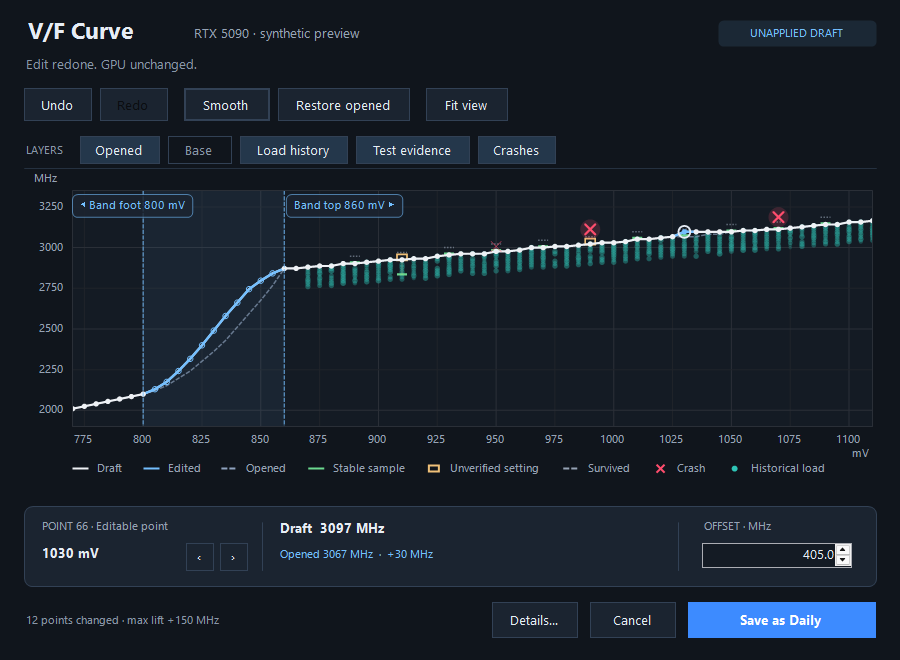

The V/F curve editor gets a focused visual and interaction pass: a quieter dark canvas, clear draft state and a persistent selected-point inspector.

*Actual Windows rendering with synthetic preview data.*

- **The opened curve stays exact.** Opening the editor no longer smooths a draft automatically. Smooth is explicit, Restore opened restores the original offsets and transition band exactly, and both actions can be undone. Undo/redo includes the band; a click or cancelled drag preserves redo history.
- **Precise edits, with context.** The inspector keeps voltage, draft effective clock, opened clock and the difference visible. Enter an offset numerically in MHz, step by 7.5 MHz, or drag points as before. Native buttons and layer switches support keyboard focus and tooltips. Ctrl+Z, Ctrl+Y / Ctrl+Shift+Z, Ctrl+S and Ctrl+0 are available; Esc cancels a drag.
- **Evidence is easier to read.** Opened curve, base clocks, historical load, test evidence and crashes have independent visibility switches. Green evidence marks show sampled clocks from stable tests. Amber hollow marks show a stable setting that was not reached, or lacks samples; a dotted connector shows the gap when known. Survived settings remain distinct. Historical load is explicitly a snapshot, not live telemetry, and none of these marks certify an untested draft.
- **A complete save flow.** Unsaved drafts prompt before closing. Save as Daily shows its verified result and locks the saved draft until you close it. Long errors and other settings included in Daily are readable and copyable through Details. Curve edits remain local until Save as Daily.

Validation includes the .NET and installer suites plus Windows checks against the real editor with synthetic data: opening, numeric edits, undo/redo, exact restore, drag cancellation, layer caching, resizing, scaled layout and success/failure save states. CI retains rendered Windows previews. GPU writes and hardware readback require a Windows machine with a supported NVIDIA card; the UI checks do not exercise a physical GPU.

Upgrade: `npx -y clocktail@latest setup`, then restart your agents. Your profiles and history remain in place.

*The zip below is for reading, inspecting and archiving. To install, use npx or your agent; the README also documents manual installation.*
